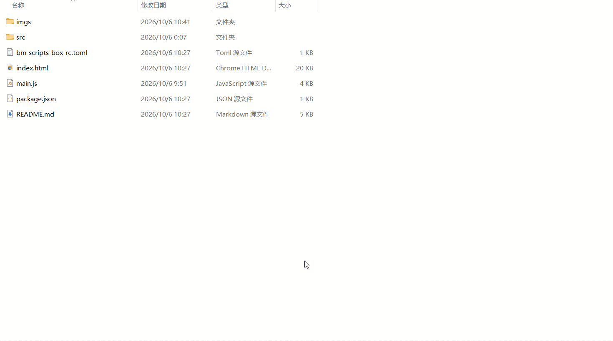

# 截图美化

> 一键截图后弹出原生窗口调参，给截图添加渐变背景、圆角和阴影，执行美化后自动写入系统剪贴板。

---

## 核心特性

- **流程顺滑**：任意方式触发都会先拉起截图工具，框选完成即弹出美化窗口；取消截图则脚本直接结束
- **原生调参窗口**：独立窗口实时预览，界面紧凑清爽、样式完全自写
- **30 种渐变预设 + 自定义渐变**：一键套用预设，或用双取色器 + 角度自定义任意渐变
- **丰富参数**：纯色背景、边距、圆角、阴影、缩放、宽高比全部可调
- **一键写回剪贴板**：点「执行美化」即把结果写入系统剪贴板，直接到目标窗口粘贴
- **多格式输出**：PNG / JPEG / WebP 三种格式可选
- **配置持久化**：执行美化时自动保存参数，下次打开窗口沿用
- **离线可用**：无任何外部依赖，样式与逻辑全部本地

---

## 脚本演示

---

## 安装方法

本脚本的运行环境、依赖组件及图形化窗口均依赖"不忙脚本盒子"，建议仅通过盒子安装和使用本脚本。

> 前置条件：安装好 [不忙脚本盒子](https://www.bm-box.cn)

* 打开盒子 → **脚本市场** → 搜索 **「截图美化」**
* 点击「安装」,等待约30秒安装完成

---

## 使用方式

- **任意入口触发**（三选一）
  - 在盒子主界面点击「截图美化」卡片
  - 在盒子「热键管理」为该脚本绑定快捷键后按下
  - 在文件资源管理器文件夹空白处右键 → 不忙脚本盒子 → 截图美化

- **截图**
  - 脚本首先唤起截图工具，拖动鼠标框选区域
  - 若取消或直接退出截图工具，脚本结束，不弹窗口

- **调参并执行美化**
  - 框选完成后自动弹出美化窗口，显示截图预览
  - 调整背景、边距、圆角、阴影、缩放、宽高比等参数，实时预览
  - 点击「✨ 执行美化」，结果写入系统剪贴板，窗口自动关闭
  - 到聊天窗口或文档中 `Ctrl+V` 粘贴即可

---

## 💡 使用提示

- 框选完成后截图工具会自动复制到剪贴板并退出，美化脚本随即读取；请确保框选后执行“复制到剪贴板”的操作（默认框选完成即复制）。
- 输出固定写回系统剪贴板；如需保存为文件，可在任意支持粘贴的工具中粘贴后另存。
- 每次「执行美化」都会保存当前参数，下次打开窗口自动沿用。

---

## 🖥️ 环境要求

| 项目 | 要求 |
| --- | --- |
| **操作系统** | Windows 10 1803+（64 位） |
| **运行环境** | Node.js >= 16（盒子自动下载） |
| **外部工具** | ScreenCapture、webview-cli（盒子自动下载） |
| **运行依赖** | `@napi-rs/canvas`（盒子自动安装） |

